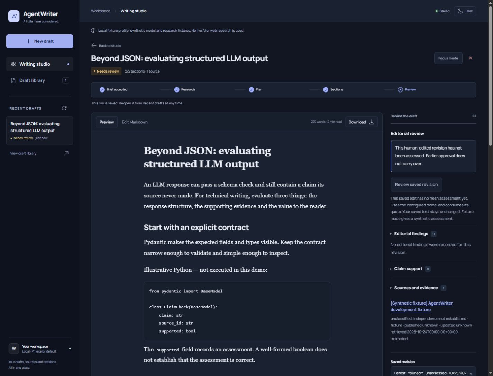
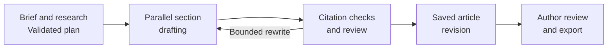

# AgentWriter

A source-aware technical writing studio built with **LangGraph, FastAPI and PostgreSQL**.

I built this as a personal **AI Engineering portfolio project** and a workspace
for writing about AI, data science and machine learning. It turns a research brief
into an editable article, keeps evidence alongside the text, and prepares posts
for Medium, LinkedIn and X. The author controls the final wording and publication.

[User guide](docs/user-guide.md) · [Setup](docs/setup-and-operations.md) · [Workflow](docs/workflow.md) · [CI](https://github.com/BatuhanYilmaz26/Agent-Writer/actions/workflows/ci.yml)

*Technical article sample edited in the local fixture profile; source and review data are synthetic.*

## AI engineering in the project

The focus is the workflow around generation: explicit contracts, retained evidence,
bounded execution and reviewable outputs.

| Engineering area | Implementation |
|---|---|
| **Stateful orchestration** | A [LangGraph](https://docs.langchain.com/oss/python/langgraph/overview) `StateGraph` with conditional research, parallel section drafting, assembly, editorial review and targeted rewrite limits. |
| **Structured LLM outputs** | Pydantic contracts validate plans, section drafts and reviews; schema repair and model dispatches have explicit limits. |
| **Evidence-grounded generation** | Bounded research adapters, stored source/excerpt identities and hashes, citation validation and conservative claim-support signals. |
| **Durable execution** | PostgreSQL graph checkpoints, an independent worker, leased job ownership, idempotency, cancellation and replayable progress events. |
| **Provider and cost controls** | OpenRouter routing, free-only defaults, request/token limits, budget accounting and explicit handling of provider failures. |
| **Editorial control** | Immutable article revisions, assessments bound to exact content hashes, editable platform variants and manual publishing. |
| **Evaluation** | A versioned fixture corpus, unit and real PostgreSQL integration tests, static checks and GitHub Actions CI. |

## Writing workflow

Generation runs in the worker, outside the HTTP request. Checkpoints and committed
progress let the browser reconnect without owning the writing process.

## In the workspace

- Discover technical topics from publisher and research feeds, inspect dates and add primary sources.
- Write in English, Turkish, Spanish, Portuguese or German, with your own angle and observations.
- Compare title suggestions, edit Markdown, inspect evidence and preserve each saved revision.
- Prepare search-preview metadata, LinkedIn/X drafts and a downloadable article bundle with an AI-assistance disclosure.
- Reopen saved drafts and record the links to articles you publish yourself.

## Technology

| Layer | Tools |
|---|---|
| Workflow and validation | Python 3.13, LangGraph, Pydantic |
| API and progress | FastAPI, Uvicorn, asyncio, Server-Sent Events |
| Persistence | PostgreSQL, Psycopg, LangGraph PostgreSQL checkpointer |
| Providers | OpenRouter, HTTPX; Treg and optional Tavily research adapters |
| Frontend | JavaScript modules, semantic HTML, CSS, safe Markdown rendering |
| Development and operations | pytest, Ruff, Mypy, Docker Compose, GitHub Actions |

## Scope and evaluation

This is a personal localhost application. The default fixture profile makes no
live model or research requests and allows the workflow to be explored without
provider credentials. Live providers require explicit configuration; free-only
routing has no paid fallback and remains subject to provider availability.

CI exercises software behavior with fixtures and a disposable PostgreSQL database.
Live article quality is a separate acceptance check. A valid schema, citation or
model assessment does not establish factual accuracy; review the article and
sources before publishing. Posting to external platforms is manual.

## Documentation and code

| Location | Contents |
|---|---|
| [User guide](docs/user-guide.md) | Drafting, editing, titles, evidence and publication bundles |
| [Setup and operations](docs/setup-and-operations.md) | Local services, verification and maintenance |
| [Configuration](docs/configuration.md) · [Providers](docs/providers.md) · [Budgets](docs/budgets.md) | Provider settings, limits and cost controls |
| `src/agentwriter/` | Domain models, workflow, providers, API, persistence, worker and browser workspace |
| `migrations/` | PostgreSQL schema migrations |
| `tests/` · `evaluation/` | Automated checks, versioned corpus and editorial rubric |
| `scripts/` · `ops/` | Verification tools, monitoring and maintenance definitions |
| `assets/` | Workspace screenshots |

Built by [@BatuhanYilmaz26](https://github.com/BatuhanYilmaz26).
For bugs and suggestions, [open an issue](https://github.com/BatuhanYilmaz26/Agent-Writer/issues)
with reproduction steps and no credentials or private draft content.
