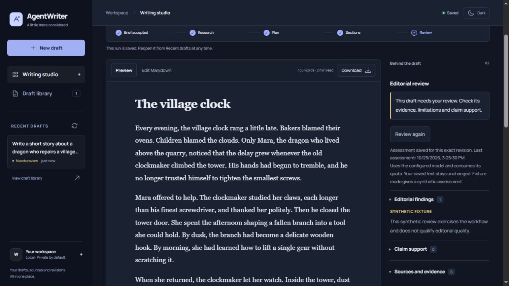

# AgentWriter

A local writing studio for concise technical articles and posts for Medium, LinkedIn and X.

[User guide](docs/user-guide.md) · [Get started](docs/setup-and-operations.md) · [Configuration](docs/configuration.md)

AgentWriter turns a brief into an editable Markdown draft. Choose your audience,
tone and language, follow the writing progress, inspect the sources, and keep
every saved revision. You decide what is ready to publish.

*Local fixture demo with sample story text. Synthetic reviews demonstrate the workflow; they do not certify writing quality.*

## What you can do

- **Write in five languages.** English, Turkish, Spanish, Portuguese and German.
- **Find a timely topic.** Refresh publisher and research feeds on demand, inspect dates and sources, and spot ideas already used in your drafts.
- **Work from your point of view.** Choose a concise technical profile, target length and research preference; add your angle, observations and primary sources.
- **Keep evidence close.** Inspect source links, citation checks and claim-support findings alongside the draft.
- **Edit with a history.** Save changes as new revisions, reopen earlier versions and download the exact Markdown you selected.
- **Request a fresh review.** Assess a saved edit without rewriting it. The assessment belongs to that revision; later edits start unassessed.
- **Prepare a publication bundle.** Edit LinkedIn/X extracts, check platform lengths, add an honest AI disclosure and export article text, HTML, Markdown and references. Posting stays in your hands.
- **Keep a publishing log.** Save the links and dates of posts you published, tied to the exact article revision.
- **Come back later.** Runs and progress are stored in PostgreSQL and processed by a separate worker.

## Get started

Follow the [setup guide](docs/setup-and-operations.md) for Windows, Linux or the
local Docker Compose profile. It covers the prerequisites, database, API and
worker in one place. After startup, open the local workspace shown by the guide.

The default fixture profile needs no AI account or API key and makes no model or
research requests. Use it to explore the complete writing and revision workflow.

To create your first draft, enter a topic, choose a language and select
**Create draft**. Open **Edit Markdown** to make changes, then save a new revision.
The [user guide](docs/user-guide.md) walks through research, review, downloads
and saved drafts.

## Local use and providers

The current application is intended for localhost. Local authentication is a
single workspace identity; hosted sign-in is not available. Keep the service on
loopback rather than exposing it publicly.

Live generation uses [OpenRouter](docs/providers.md#openrouter), with
`openrouter/free` as the default model selection. Research can use
[Treg](docs/providers.md#treg); Tavily is an optional, separately configured
adapter. External calls require explicit server configuration and account checks.
Free-only routing never falls back to a paid model, but capacity and model
capabilities can vary between requests.

Review source support, language fluency and editorial findings before publishing.
An AI assessment or a valid citation does not establish that a claim is true.
Fixture output is labeled synthetic, and non-English drafts require your review.

## Documentation

| Guide | What it covers |
|---|---|
| [User guide](docs/user-guide.md) | Creating, editing, reviewing and managing drafts |
| [Setup and operations](docs/setup-and-operations.md) | Installation, local services, tests and maintenance |
| [Configuration](docs/configuration.md) | Languages, providers, quotas and limits |
| [Writing workflow](docs/workflow.md) | Planning, research, generation and review |
| [Providers](docs/providers.md) | Account checks, routing, privacy and citations |
| [Budgets](docs/budgets.md) | Request limits, cost accounting and retries |

## Project structure

| Path | Contents |
|---|---|
| `src/agentwriter/` | Application, browser workspace, writing workflow and worker |
| `migrations/` | PostgreSQL schema migrations |
| `tests/` | Unit and integration tests |
| `evaluation/` | Versioned editorial rubric and regression corpus |
| `scripts/` | Development and verification tools |
| `ops/` | Monitoring and maintenance service definitions |
| `docs/` | Product and operating guides |
| `assets/` | Product screenshots |

## Help and feedback

Start with [troubleshooting](docs/user-guide.md#troubleshooting) for common issues.
For a bug or feature request, [open an issue](https://github.com/BatuhanYilmaz26/Agent-Writer/issues).
Include the steps to reproduce and what you expected. Leave out API keys,
connection strings and private draft content.

Maintained by [@BatuhanYilmaz26](https://github.com/BatuhanYilmaz26).
