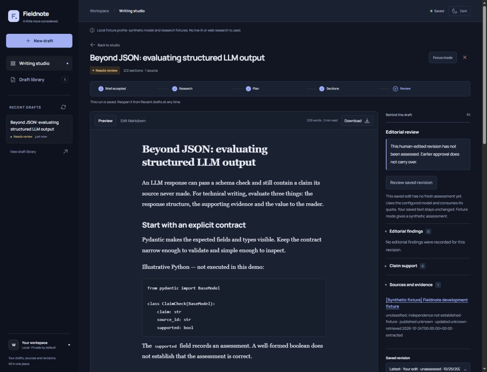
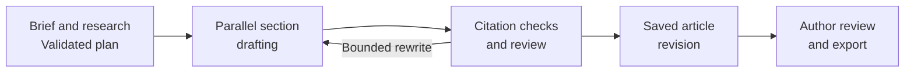

# Fieldnote

Fieldnote is an application for researching, drafting and reviewing technical
articles. It uses **LangGraph** to orchestrate LLM workflows, **FastAPI** for the
application API, and **PostgreSQL** for checkpoints, research records and versioned
articles.

The writing workspace combines editable Markdown with a source ledger, editorial
assessments and revision history. It prepares publication bundles for Medium,
LinkedIn and X, keeping research and review attached to the article as it moves
from an initial brief to a publishable draft.

[User guide](docs/user-guide.md) · [Setup](docs/setup-and-operations.md) · [Workflow](docs/workflow.md) · [CI](https://github.com/BatuhanYilmaz26/Fieldnote/actions/workflows/ci.yml)

*Technical article sample edited in the local fixture profile; source and review data are synthetic.*

## Architecture

The FastAPI service accepts writing requests, stores their execution state and
streams committed progress events to the browser. A separate worker executes a
[LangGraph](https://docs.langchain.com/oss/python/langgraph/overview) `StateGraph`
and persists checkpoints to PostgreSQL.

Research is selected according to the brief's policy. A validated plan allocates
section budgets and evidence, sections are drafted concurrently, and the assembled
article passes through citation checks and editorial review. Review findings can
route selected sections through a bounded rewrite loop.

The browser can reconnect to persisted progress while generation continues in the
worker. Saved edits create new article revisions, and each assessment belongs to
the exact revision it reviewed.

## Capabilities

- **Research and source inspection:** discover topics from publisher and research feeds, inspect source dates, and supply primary references and author observations.
- **Multilingual drafting:** generate articles in English, Turkish, Spanish, Portuguese or German with a configurable audience, tone and target length.
- **Editorial workflow:** compare headline suggestions, edit Markdown, inspect claim-support findings and request assessments of saved revisions.
- **Publication preparation:** edit search-preview metadata and LinkedIn/X variants, validate platform lengths, and export article text, HTML, Markdown and references.
- **Persistent workspace:** reopen drafts, inspect revision history and record published links against the corresponding article package.

## Design decisions

| Concern | Approach |
|---|---|
| **LLM output contracts** | Pydantic validates plans, section drafts and editorial reviews before downstream processing. Schema repair attempts have explicit limits. |
| **Source traceability** | Sources and excerpts retain identifiers and content hashes. Citation links resolve through the stored ledger; claim-support checks surface gaps for review. |
| **Execution ownership** | Leased jobs, idempotency and PostgreSQL checkpoints separate durable execution from individual HTTP requests and browser connections. |
| **Bounded generation** | Section concurrency, rewrite rounds, request/token limits and cost reservations constrain each run. Free-only routing does not fall back to paid models. |
| **Review integrity** | Immutable Markdown revisions and content hashes bind assessments and publication packages to specific article versions. Later edits start unassessed. |
| **Operational visibility** | Persisted events, worker heartbeats, readiness checks, metrics and redacted structured logs expose progress and failures without logging provider credentials. |

## Technology

| Layer | Tools |
|---|---|
| Workflow and validation | Python 3.13, LangGraph, Pydantic |
| API and progress | FastAPI, Uvicorn, asyncio, Server-Sent Events |
| Persistence | PostgreSQL, Psycopg, LangGraph PostgreSQL checkpointer |
| Providers | OpenRouter, HTTPX; Treg and optional Tavily research adapters |
| Frontend | JavaScript modules, semantic HTML, CSS, safe Markdown rendering |
| Development and operations | pytest, Ruff, Mypy, Docker Compose, GitHub Actions |

## Evaluation and verification

The versioned evaluation corpus covers workflow contracts, citation identity,
research-policy enforcement, word budgets and adversarial inputs. Deterministic
fixtures make these checks reproducible without consuming model quota.

Unit and integration tests exercise the API, worker, PostgreSQL persistence,
cancellation, replayable progress, revision history and budget accounting. GitHub
Actions runs the fixture smoke test, corpus regression checks, automated tests,
type checking and linting.

These checks validate software behavior. Live article quality requires separate
provider and editorial evaluation; citation validity and model assessments alone
do not establish factual accuracy.

## Local deployment

Fieldnote runs as a browser workspace, API, worker and PostgreSQL database. The
default fixture profile supports local exploration without provider credentials
or external requests. Live model and research adapters require explicit
configuration and remain subject to provider availability.

Articles and platform variants are exported for manual publication. Review the
claims, source dates, technical examples and AI-assistance disclosure before
posting. Installation and operating instructions are in the
[setup guide](docs/setup-and-operations.md).

## Documentation and code

| Location | Contents |
|---|---|
| [User guide](docs/user-guide.md) | Drafting, editing, titles, evidence and publication bundles |
| [Setup and operations](docs/setup-and-operations.md) | Local services, verification and maintenance |
| [Configuration](docs/configuration.md) · [Providers](docs/providers.md) · [Budgets](docs/budgets.md) | Provider settings, limits and cost controls |
| `src/fieldnote/` | Domain models, workflow, providers, API, persistence, worker and browser workspace |
| `migrations/` | PostgreSQL schema migrations |
| `tests/` · `evaluation/` | Automated checks, versioned corpus and editorial rubric |
| `scripts/` · `ops/` | Verification tools, monitoring and maintenance definitions |
| `assets/` | Workspace screenshots |

Built by [@BatuhanYilmaz26](https://github.com/BatuhanYilmaz26).
For bugs and suggestions, [open an issue](https://github.com/BatuhanYilmaz26/Fieldnote/issues)
with reproduction steps and no credentials or private draft content.
